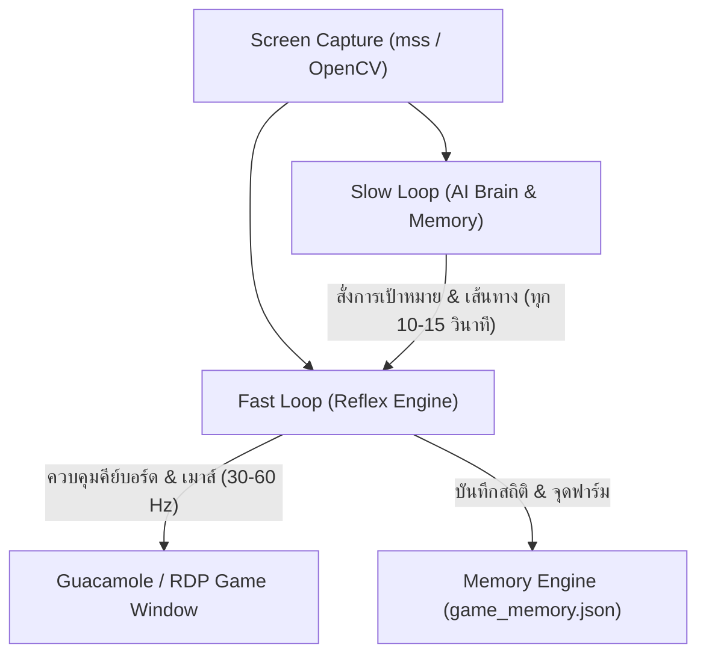

# ระบบและสถาปัตยกรรม AI สำหรับการเล่นเกม MMORPG อัตโนมัติ (AI MMORPG Full Engine)

เอกสารฉบับนี้อธิบายรายละเอียดโครงสร้าง สถาปัตยกรรม และการทำงานของระบบ AI Agent สำหรับเล่นเกม MMORPG อัตโนมัติ โดยอ้างอิงจากโมเดลระดับสูง เช่น **SIMA (Google DeepMind)**, **CRADLE**, และ **Voyager (Code-as-Policies)** รวมไปถึงการผสานสถาปัตยกรรม **Dual-Loop Architecture**, **Computer Vision (OpenCV/YOLO)**, และ **ระบบความจำ (Mnemosyne Memory Engine)**

---

## 1. สถาปัตยกรรมแบบวงจรคู่ (Dual-Loop Architecture)

เนื่องจากเกมแนว MMORPG มีความซับซ้อน ต้องการทั้งการวางแผนระยะยาว (การเดินแผนที่, การทำเควสต์, การเลือกจุดฟาร์ม) และการตอบสนองที่รวดเร็วระดับมิลลิวินาที (การหลบสกิล, การใช้สกิลคอมโบ, การกดโพชั่น) จึงต้องแบ่งระบบการประมวลผลออกเป็น 2 ลูปหลัก:



### รายละเอียดการทำงานของแต่ละลูป

| คุณสมบัติ | Slow Loop (ลูปคิดวิเคราะห์และนำทาง) | Fast Loop (ลูปรีเฟล็กซ์และต่อสู้) |
| :--- | :--- | :--- |
| **เทคโนโลยีที่ใช้** | **Unsloth Qwen2.5-VL-7B / Qwen3-VL-4B (VRAM ~4.5 GB)** + Mnemosyne Memory Engine | **YOLOv11n / OpenCV HSV (VRAM ~0.5 GB, 60 FPS)** + Native CDP / Win32 API |
| **ความถี่การทำงาน** | ทุกๆ 10 ถึง 15 วินาที | 30 ถึง 60 ครั้งต่อวินาที (30-60 Hz) |
| **หน้าที่หลัก** | - วิเคราะห์ Minimap และเลือกจุดฟาร์มที่มีมอนสเตอร์หนาแน่น<br>- ประเมินความเสี่ยงและส่งแผนกลยุทธ์ (AoE / Snipe / Retreat)<br>- บันทึกพิกัดและอัตราการได้รับ EXP/ชม. ลงใน [`game_memory.json`](file:///c:/Users/asuslap/git/testbb/game_memory.json) | - ล็อกเป้าหมายมอนสเตอร์บนหน้าจอด้วย YOLOv11n / OpenCV<br>- ปรับเปลี่ยนคอมโบสกิลตามคำแนะนำของ VLM แบบไดนามิก<br>- ตรวจสอบระดับ HP และกดกระโดดหลบ (`4`) + โพชั่น (`5`) อัตโนมัติ<br>- รีโหลดกระสุน Gunslinger (`0`) |

---

## 2. ระบบการรับรู้หน้าจอและจำมอนสเตอร์ (Computer Vision & Monster Detector)

ระบบการมองเห็นใช้วิธีการประมวลผลภาพ 2 ระดับเพื่อค้นหามอนสเตอร์และนำทาง:

### 2.1 การตรวจจับมอนสเตอร์บน Minimap (Minimap Radar Detection)
- สแกนพื้นที่มุมขวาบนของหน้าจอ (Minimap)
- ใช้การกรองสีแบบ **HSV Color Segmentation** เพื่อแยกแยะจุดสีแดง (Red Dots) ที่แทนตำแหน่งของมอนสเตอร์ในแผนที่ย่อ
- ช่วงค่าสี HSV สำหรับจุดมอนสเตอร์สีแดง:
  - Range 1: `Hue 0-10, Saturation 120-255, Value 120-255`
  - Range 2: `Hue 170-180, Saturation 120-255, Value 120-255`

### 2.2 การตรวจจับหลอดเลือดมอนสเตอร์บนหน้าจอหลัก (Main Viewport HP Bar Detection)
- สแกนพื้นที่กึ่งกลางหน้าจอหลักเพื่อค้นหาหลอดเลือดมอนสเตอร์ (Overhead Red HP Bars)
- ใช้ Contour Filtering ตรวจสอบสัดส่วนรูปทรงสี่เหลี่ยมผืนผ้าของหลอดเลือด (`Width 15-120px, Height 3-15px`)
- ส่งคืนพิกัด `(x, y)` ของมอนสเตอร์ตัวที่ใกล้ที่สุดเพื่อให้เอเจนต์คลิกล็อกเป้าหมาย

---

## 3. ระบบความจำและการสะสมประสบการณ์ (Mnemosyne Memory System)

ระบบความจำทำหน้าที่บันทึกและดึงข้อมูลมาใช้วางแผนระยะยาว เพื่อให้เอเจนต์เก่งขึ้นตามเวลา:

1. **Spatial Memory (ความจำด้านมิติสัมพันธ์และจุดฟาร์ม):**
   - บันทึกชื่อแผนที่ พิกัด `(x, y)` ประเภทมอนสเตอร์ และอัตราการได้รับ EXP ต่อชั่วโมง
   - เมื่อมอนสเตอร์ในจุดปัจจุบันหมด เอเจนต์จะดึงพิกัดจุดฟาร์มที่ดีที่สุดจากฐานข้อมูลขึ้นมานำทางต่อ

2. **Skill Policy Memory (ความจำด้านคอมโบและเงื่อนไขการใช้สกิล):**
   - บันทึกกฎและเงื่อนไขการใช้สกิลเฉพาะของ Gunslinger (Code-as-Policies):
     - **สกิล 1 (AoE ตามตำแหน่งเมาส์):** เล็งและปล่อยสกิล AoE ที่ตำแหน่งเมาส์ (`win_move_mouse` -> `1` -> `win_click`)
     - **สกิล 2 (Single Target ตามตำแหน่งเมาส์):** เล็งยิงเป้าหมายเดี่ยวที่เมาส์ (`2`)
     - **สกิล Q (Single Target ตามตำแหน่งเมาส์):** เล็งยิงเป้าหมายเดี่ยวที่เมาส์ (`Q`)
     - **สกิล 3 (Pull Monsters ในวงกลมตามตำแหน่งเมาส์):** รวบดึงมอนสเตอร์รอบวงกลมตำแหน่งเมาส์ (`3`)
     - **สกิล 4 (Jump Dodge):** สกิลกระโดดหลบหลีก
     - **สกิล T (AoE รอบตัว):** **ต้องทำคอมโบกดสกิล 3 ตามด้วย Y ก่อนใช้สกิล T เสมอ (`3` -> `Y` -> `T`)**
     - **สกิล 6 (Buff):** สกิลบัฟพละกำลัง
     - **สกิล 0 (Reload):** สกิลรีโหลดกระสุน Gunslinger

3. **Temporal Experience Tracking (การบันทึกสถิติการเติบโต):**
   - บันทึกระดับ Base Level, Job Level, และช่วงเวลาที่ได้รับ EXP เพื่อใช้วิเคราะห์ประสิทธิภาพการฟาร์ม

---

## 4. โครงสร้างไฟล์และการเชื่อมโยงในระบบ (System Codebase Architecture)

ระบบประกอบด้วย 4 โมดูลหลักที่ทำงานประสานกันอย่างสมบูรณ์:

```
c:/Users/asuslap/git/testbb/
├── AI_MMORPG_Strategies.md    # เอกสารอธิบายสถาปัตยกรรมและกลยุทธ์ระบบ AI
├── qwen_vlm_agent.py          # โมดูล Local VLM Strategic Brain (Qwen2.5-VL-7B ผ่าน vLLM Engine)
├── test_qwen_vlm.py           # สคริปต์ทดสอบการประมวลผลรูปภาพและ JSON directive ของ Qwen2.5-VL
├── browser_playwright_bot.py  # สคริปต์ควบคุมเบราว์เซอร์ Guacamole ด้วย Playwright API + Qwen2.5-VL Slow Loop
├── auto_grind_bot.py           # สคริปต์รัน Dual-Loop Engine ผ่าน Native Win32 API
├── monster_vision.py          # โมดูล Computer Vision สแกนหาหลอดเลือดมอนสเตอร์และ Minimap
├── memory_engine.py           # โมดูล Mnemosyne จัดการความจำและบันทึกจุดฟาร์ม
└── game_memory.json           # ฐานข้อมูล JSON บันทึกความจำ สถิติ และพิกัดจุดฟาร์ม
```

### 4.0 การตั้งค่า Local Inference Engine (Unsloth vs vLLM)

#### Option 1: รันผ่าน Unsloth FastVisionModel (เร็วขึ้น 2 เท่า, ใช้ VRAM ลดลง 70%)
โมเดล: `unsloth/Qwen2.5-VL-7B-Instruct-bnb-4bit` (ใช้ VRAM เพียง ~4.5 - 5.0 GB เหมาะกับ RTX 4060 8GB)

```bash
# ติดตั้ง Unsloth
pip install --upgrade pip
pip install "unsloth[cu124-torch250] @ git+https://github.com/unslothai/unsloth.git"
```

#### Option 2: รันผ่าน vLLM Server (WSL2 Linux)
```bash
FLASHINFER_ENABLE_UVA=0 VLLM_ATTENTION_BACKEND=FLASH_ATTN VLLM_USE_V1=0 \
vllm serve Qwen/Qwen2.5-VL-7B-Instruct-AWQ \
  --port 8000 \
  --gpu-memory-utilization 0.65 \
  --max-model-len 4096 \
  --enforce-eager \
  --trust-remote-code
```

### 4.1 ซอร์สโค้ดระบบความจำ (`memory_engine.py`)

```python
import os
import json
import time

MEMORY_FILE_PATH = os.path.join(os.path.dirname(__file__), "game_memory.json")

class MemoryEngine:
    def __init__(self, memory_file=MEMORY_FILE_PATH):
        self.memory_file = memory_file
        self.memory_data = self._load_memory()

    def _load_memory(self):
        if os.path.exists(self.memory_file):
            try:
                with open(self.memory_file, 'r', encoding='utf-8') as f:
                    return json.load(f)
            except Exception as e:
                print(f"[Memory Warning] {e}")
        
        return {
            "character_profile": {"name": "M33POOH", "class": "Gunslinger", "base_level": 80, "job_level": 45},
            "farming_hotspots": [
                {"name": "Pier Coastal Beach", "x": 1820, "y": 80, "mob_type": "Shark/Turtle", "exp_rate_hr": 45000},
                {"name": "Upper Shore Cliff", "x": 1840, "y": 50, "mob_type": "Turtle Cluster", "exp_rate_hr": 52000}
            ],
            "skill_policies": {
                "Gunslinger_AoE": {
                    "buff_skill": "6",
                    "aoe_combo": ["1", "3", "2", "4", "Q", "E", "R"],
                    "reload_skill": "0",
                    "heal_skill": "5"
                }
            },
            "exp_history": []
        }

    def get_optimal_farming_spot(self):
        spots = self.memory_data.get("farming_hotspots", [])
        if spots:
            return max(spots, key=lambda s: s.get("exp_rate_hr", 0))
        return {"name": "Default Spot", "x": 1820, "y": 80}
```

### 4.2 ซอร์สโค้ดระบบมองเห็นมอนสเตอร์ (`monster_vision.py`)

```python
import numpy as np
import mss
import cv2
from PIL import ImageGrab

class MonsterDetector:
    def __init__(self, screen_width=1920, screen_height=1080):
        self.screen_width = screen_width
        self.screen_height = screen_height

    def capture_screenshot(self):
        try:
            with mss.MSS() as sct:
                monitor = sct.monitors[1]
                sct_img = sct.grab(monitor)
                frame = np.array(sct_img)
                return cv2.cvtColor(frame, cv2.COLOR_BGRA2BGR)
        except Exception:
            img = ImageGrab.grab()
            frame = np.array(img)
            return cv2.cvtColor(frame, cv2.COLOR_RGB2BGR)

    def find_minimap_monsters(self, frame):
        h, w, _ = frame.shape
        minimap = frame[int(h * 0.01):int(h * 0.19), int(w * 0.87):int(w * 0.99)]
        hsv = cv2.cvtColor(minimap, cv2.COLOR_BGR2HSV)
        
        mask1 = cv2.inRange(hsv, np.array([0, 120, 120]), np.array([10, 255, 255]))
        mask2 = cv2.inRange(hsv, np.array([170, 120, 120]), np.array([180, 255, 255]))
        red_mask = mask1 | mask2

        contours, _ = cv2.findContours(red_mask, cv2.RETR_EXTERNAL, cv2.CHAIN_APPROX_SIMPLE)
        targets = []
        for c in contours:
            if 2 <= cv2.contourArea(c) <= 150:
                M = cv2.moments(c)
                if M["m00"] != 0:
                    cx = int(M["m10"] / M["m00"]) + int(w * 0.87)
                    cy = int(M["m01"] / M["m00"]) + int(h * 0.01)
                    targets.append((cx, cy))
        return targets

    def get_best_target(self):
        frame = self.capture_screenshot()
        minimap_mobs = self.find_minimap_monsters(frame)
        if minimap_mobs:
            return minimap_mobs[0], "MINIMAP_RADAR_MOB"
        return (1820, 80), "DEFAULT_WAYPOINT"
```

### 4.3 ซอร์สโค้ดสคริปต์หลัก (`auto_grind_bot.py`)

```python
import time
import ctypes
from monster_vision import MonsterDetector
from memory_engine import MemoryEngine

VK_KEYS = {
    '1': 0x31, '2': 0x32, '3': 0x33, '4': 0x34, '5': 0x35,
    '6': 0x36, '7': 0x37, '8': 0x38, '9': 0x39, '0': 0x30,
    'q': 0x51, 'w': 0x57, 'e': 0x45, 'r': 0x52
}

def win_press_key(char):
    vk = VK_KEYS.get(char.lower())
    if vk:
        ctypes.windll.user32.keybd_event(vk, 0, 0, 0)
        time.sleep(0.05)
        ctypes.windll.user32.keybd_event(vk, 0, 2, 0)

def win_click(x, y):
    ctypes.windll.user32.SetCursorPos(x, y)
    ctypes.windll.user32.mouse_event(2, 0, 0, 0, 0)
    time.sleep(0.05)
    ctypes.windll.user32.mouse_event(4, 0, 0, 0, 0)

class AutoGrindBot:
    def __init__(self):
        self.detector = MonsterDetector()
        self.memory = MemoryEngine()
        self.last_slow_loop_time = 0.0

    def fast_loop_attack(self):
        policy = self.memory.get_skill_policy()
        win_press_key(policy.get("buff_skill", "6"))
        time.sleep(0.1)
        for skill in policy.get("aoe_combo", ['1', '3', '2', '4']):
            win_press_key(skill)
            time.sleep(0.05)
        win_press_key(policy.get("reload_skill", "0"))

    def slow_loop_search_mobs(self):
        target_coords, target_type = self.detector.get_best_target()
        if target_type == "DEFAULT_WAYPOINT":
            spot = self.memory.get_optimal_farming_spot()
            target_coords = (spot["x"], spot["y"])
        win_click(target_coords[0], target_coords[1])
        time.sleep(1.5)

    def run_continuous(self, duration_seconds=60):
        start_time = time.time()
        while time.time() - start_time < duration_seconds:
            self.fast_loop_attack()
            if time.time() - self.last_slow_loop_time > 10.0:
                self.slow_loop_search_mobs()
                self.last_slow_loop_time = time.time()
            time.sleep(0.2)

if __name__ == "__main__":
    bot = AutoGrindBot()
    bot.run_continuous(duration_seconds=30)
```

---

## 5. ระบบการฟาร์มอัตโนมัติระยะยาวและการกู้คืนการเชื่อมต่อ (Long-Term AFK Daemon Mode & Auto-Reconnect)

เพื่อรองรับการเปิดฟาร์มทิ้งไว้ระยะยาวโดยไม่ต้องเฝ้าหน้าจอ ระบบได้เพิ่มฟีเจอร์ความปลอดภัยและการฟื้นฟูตัวเองอัตโนมัติ (Self-Healing System):

1. **Auto Disconnect Recovery (การเชื่อมต่อใหม่เมื่อหลุด):**
   - โมดูล `MonsterDetector` สแกนหาคำว่า *"You have been disconnected"* และปุ่ม **Reconnect** ในเซสชัน Guacamole RDP
   - เมื่อตรวจพบการหลุด ระบบจะทำการคลิกปุ่ม Reconnect (`X: 473, Y: 524`) อัตโนมัติและรอ 4 วินาทีเพื่อให้สัญญาณภาพ RDP กลับมาใช้งานได้ตามปกติ

2. **Auto HP Potion Maintainer:**
   - ระบบจะส่งคำสั่งกดสกิลฟื้นฟูเลือด/กดโพชั่น (`5`) โดยอัตโนมัติทุกๆ 15 วินาทีใน Fast Loop เพื่อป้องกันตัวละครตายระหว่างฟาร์ม

3. **Spatial Memory Auto-Saving:**
   - พิกัดจุดฟาร์มมอนสเตอร์หนาแน่นจะถูกอัปเดตและบันทึกลงในไฟล์ [game_memory.json](file:///c:/Users/asuslap/git/testbb/game_memory.json) ตลอดเวลา

---

## 6. สรุปวิธีเปิดรันใช้งานระบบฟาร์มอัตโนมัติ

1. ตรวจสอบให้หน้าต่าง Guacamole RDP เปิดค้างไว้อยู่ในเบราว์เซอร์
2. เปิด Terminal และสั่งรันสคริปต์ Playwright Continuous Bot:
   ```powershell
   python c:\Users\asuslap\git\testbb\browser_playwright_bot.py
   ```
3. ระบบจะทำงานในโหมด **AFK Continuous Daemon** โดยอัตโนมัติ พร้อมตรวจจับมอนสเตอร์ ใช้สกิลคอมโบตามกฎ นำทางตาม Minimap บันทึกความจำ และกดเชื่อมต่อใหม่หากเน็ตหลุด โดยไม่ต้องเฝ้าหน้าจอ